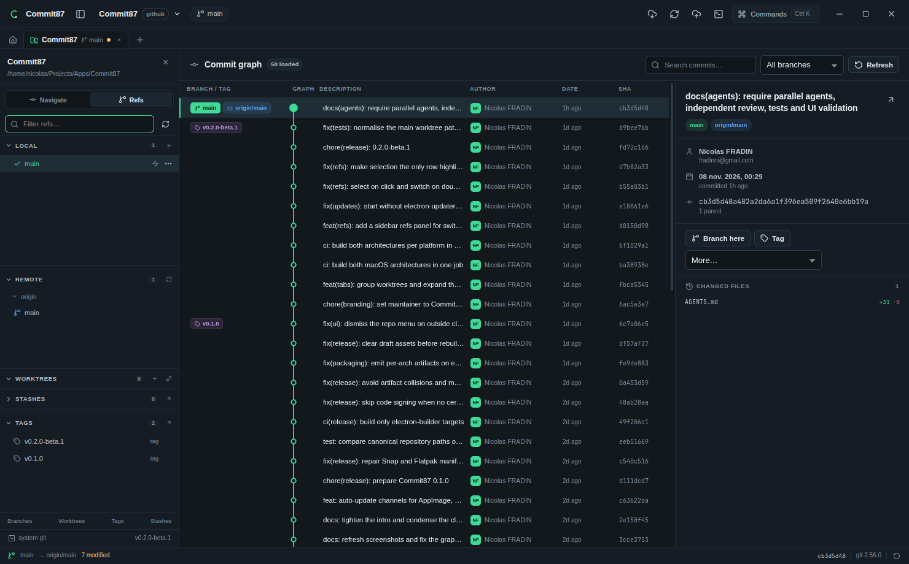

<div align="center">
  <a href="https://github.com/fradinni/Commit87">
    
  </a>

  <p><strong>Every commit counts.</strong> A focused desktop Git client for people who already like Git.</p>

  [](https://github.com/fradinni/Commit87/releases) [](LICENSE) [](https://github.com/fradinni/Commit87/releases) [](https://github.com/fradinni/Commit87/actions/workflows/ci.yml)

  <a href="https://github.com/fradinni/Commit87/releases">
    
  </a>
  <a href="https://github.com/fradinni/Commit87/releases">
    
  </a>
</div>

<p align="center">
  <a href="#about">About</a> ·
  <a href="#features">Features</a> ·
  <a href="#install">Install</a> ·
  <a href="#usage">Usage</a> ·
  <a href="#developers">Developers</a> ·
  <a href="#license">License</a>
</p>


## About

Commit87 is a cross-platform desktop Git client for Linux, macOS and Windows. It provides a
graphical interface for repositories, history, branches, worktrees, code review and forge
integrations, while every version-control operation is executed by the Git CLI itself rather
than a reimplementation. Existing hooks, filters, LFS, GPG signing, SSH configuration and
`includeIf` identities therefore continue to apply.

The client covers staging and commits, commit graph navigation, branch and tag management,
linked worktrees, submodules and stashes, plus pull requests, releases and pipelines where
each forge supports them. Multiple identities and forge accounts can be configured and bound
per repository, per remote or per push.

Commit87 is built with Electron, React and TypeScript, with no compiled native add-ons and
no Git reimplementation. Git commands and provider API calls run in the main process,
credentials are kept in the OS credential store when available, and the sandboxed renderer
communicates through one validated IPC channel.

## Features

- **Commit graph** with lanes, refs, search, multi-select and per-commit actions: branch,
  tag, checkout detached, cherry-pick, revert and reset.
- **Repository tabs**: keep several repositories open at once, each with its own selection,
  status and console.
- **Branches, worktrees and refs**: a keyboard-first refs panel, conflict-aware merge and
  rebase continuation, submodules, tags and stashes.
- **Review and code browsing**: unified diffs with per-file stats, file tree at `HEAD` or in
  the worktree, syntax highlighting, blame and open in your editor.
- **Forge integrations** for GitHub, GitLab, Bitbucket and Gitea: pull requests, releases
  and pipelines or workflow runs where the forge exposes them, matched to the right account
  per remote.
- **Built for the keyboard** with a command palette and a git-only console that cannot spawn
  a shell.
- **In-place updates** for AppImage, Windows and macOS builds, with stable and beta channels.

| Commit graph | Staging |
| --- | --- |
|  |  |

| Refs panel | Git console |
| --- | --- |
|  |  |

## Install

Prebuilt packages are published for every release. **Git 2.30+ must be on your `PATH`** or
selected in **Settings → System Git** (the Flatpak and Snap bundles ship their own Git).
Node.js is only needed to build from source. Linux packages are unsigned, so the checksum
from the same release is the integrity gate. Recent releases publish `SHA256SUMS.txt`,
`BUILD-INFO.txt` and `SIGNING-STATUS.txt`; verify downloads against them.

| Platform | Recommended | Also available |
| --- | --- | --- |
| macOS | [install script](#macos) — app auto-updates | `.dmg`, `.zip` (Apple Silicon and Intel) |
| Linux | [AppImage](#linux) — app auto-updates | `.deb`, `.rpm`, `.pkg.tar.xz` (pacman), `.tar.gz` |
| Windows | [NSIS installer](#windows) — app auto-updates | portable `.exe`, `.zip` (x64 and arm64) |

### macOS

The installer script downloads the newest release with `curl`, verifies it against
`SHA256SUMS.txt` and installs to `~/Applications`. After the first install,
**Settings → Updates** uses the same verified release archive to update the app in place:

```bash
curl -fsSL https://raw.githubusercontent.com/fradinni/Commit87/main/scripts/install-macos.sh | bash
```

The script resolves the newest version with `python3`, which ships with the Xcode Command
Line Tools; pin `--version` to skip that lookup. Useful options:

```bash
# Follow stable releases only
curl -fsSL https://raw.githubusercontent.com/fradinni/Commit87/main/scripts/install-macos.sh \
  | bash -s -- --channel stable

# Check the newest version, or remove the installed copy
curl -fsSL https://raw.githubusercontent.com/fradinni/Commit87/main/scripts/install-macos.sh \
  | bash -s -- --check
curl -fsSL https://raw.githubusercontent.com/fradinni/Commit87/main/scripts/install-macos.sh \
  | bash -s -- --uninstall
```

Install to `/Applications` with `--system`, pin a tag with
`--version v0.2.0-beta.10`, or install somewhere else with `--to <dir>`. The script is also
attached to the newest release, so you can download and run it locally if you prefer to read
it first.

> [!WARNING]
> The `.dmg` and `.zip` are manual installs. Copy Commit87 to a writable folder (for
> example `~/Applications`) before launching it: a copy running from the mounted disk image
> cannot update itself. Automatic updates require that writable location — use the install
> script above if you want updates handled for you.

### Linux

The AppImage is a single file, runs on most distributions and updates in place.

1. Download the **AppImage** for your architecture from the
   [latest release](https://github.com/fradinni/Commit87/releases) (`x86_64` or `arm64`).
2. Make it executable and run it:

```bash
chmod +x Commit87-*-linux-x86_64.AppImage
./Commit87-*-linux-x86_64.AppImage
```

<sub>On ARM, use the `arm64` AppImage. If FUSE 2 is unavailable (Ubuntu 22.04+ ships it
separately), launch with `--appimage-extract-and-run` instead.</sub>

Package formats are attached to the same release:

```bash
# Debian / Ubuntu / Mint
sudo apt install ./Commit87-*-linux-amd64.deb

# Fedora / RHEL
sudo dnf install ./Commit87-*-linux-x86_64.rpm

# openSUSE
sudo zypper install ./Commit87-*-linux-x86_64.rpm

# Arch / Manjaro
sudo pacman -U ./Commit87-*-linux-x64.pkg.tar.xz

# Any distro, no install
tar -xzf Commit87-*-linux-x64.tar.gz
```

<sub>On ARM the artifacts are `-linux-arm64` (AppImage, deb, tar.gz) or `-linux-aarch64`
(rpm, pkg.tar.xz).</sub>

Flatpak and Snap bundles are built from source (`npm run dist:flatpak`,
`npm run dist:snap`) because their sandbox cannot use the host binaries: Snap stages Git,
OpenSSH and CA certificates, and the Flatpak builds Git and uses the runtime's SSH and CA
bundle. Package-manager builds are not patched in place; the package manager or software
center owns the update, and portable or zip copies are replaced by downloading the next
release.

### Windows

Download the `*-win-x64-setup.exe` (or `*-win-arm64-setup.exe`) installer from the
[latest release](https://github.com/fradinni/Commit87/releases). Portable `.exe` and `.zip`
builds are attached too. Installers are unsigned unless the release configured a
certificate, so SmartScreen may ask for confirmation; `SIGNING-STATUS.txt` records what each
build actually did.

## Usage

1. **Open**, **Clone** or **Init** a repository from the launchpad.
2. Pick an identity and, for forge features, an integration account in **Settings**.
3. Stage files, write a message and press `Ctrl/Cmd + Enter` to commit.
4. Push, then open review from the pull request view for the repository's remote.

| Shortcut | Action |
| --- | --- |
| `Ctrl/Cmd + K` | Command palette (commands, branches, recent repositories) |
| `Ctrl/Cmd + J` | Toggle the git console |
| `Ctrl/Cmd + O` | Open repository |
| `Ctrl/Cmd + Shift + O` | Clone repository |
| `Ctrl/Cmd + Enter` | Commit from the message box |

See [Getting started](docs/getting-started.md) for system Git discovery, token scopes and
repository grants, and [Recovery](docs/recovery.md) for what discard, submodule removal and
interrupted operations leave behind.

## Developers

Requirements: **Node.js 24+** and **Git 2.30+**. There are no native modules to compile.

```bash
npm install          # or npm ci
npm run dev          # electron-vite dev server with HMR
npm run typecheck    # strict TypeScript for main, preload and renderer
npm test             # unit and integration tests against real git
npm run build        # production bundles in out/
npm run pack:dir     # unpacked app in dist/
```

`npm run dev` and `npm run start` provision the Electron runtime first;
`npm run ensure:electron -- --check` reports without downloading. Build installers with
`npm run build:linux`, `npm run build:win` or `npm run build:mac` (Windows and macOS
packaging must run on a matching host or in CI). Linux packaging also needs `fakeroot`,
`rpm` and `bsdtar` (`libarchive-tools`); see the
[packaging details](docs/packaging.md#linux-packaging-details).

Layout and boundaries:

```
src/main/       Electron main: Git, providers, IPC, secrets, updates (full privileges)
src/preload/    contextBridge surface: invoke and event subscriptions only
src/shared/     pure domain types and the typed IPC contract
src/renderer/   React UI (sandboxed: no Node, no secrets, no direct network)
tests/          Vitest suites against temporary repositories and mocked fetch
docs/           architecture, guides, recovery, packaging, testing, screenshots
```

Extending IPC means adding to `IpcMethods` in `src/shared/ipc.ts`, a type in
`src/shared/types.ts`, and the decoder/handler entries in `src/main/ipc/router.ts`. Never
bypass `src/renderer/src/lib/ipc.ts`, and never interpolate shell strings when spawning Git.

More documentation:

- [Architecture](docs/architecture.md) — processes, IPC contract, Git execution, providers,
  updates and the security model.
- [Packaging](docs/packaging.md) and [Testing](docs/testing.md) — platform tiers, release
  workflow and the suites.
- [Contributing](CONTRIBUTING.md) — review expectations and verification gates.
- [Security](SECURITY.md) — how to report a vulnerability.

## License

MIT — see [LICENSE](LICENSE).
