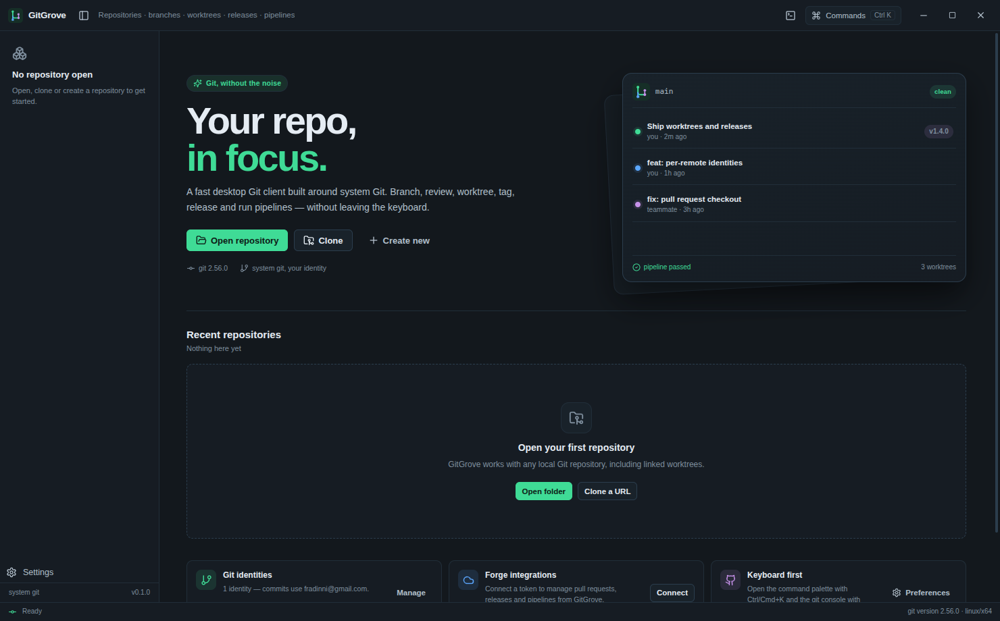
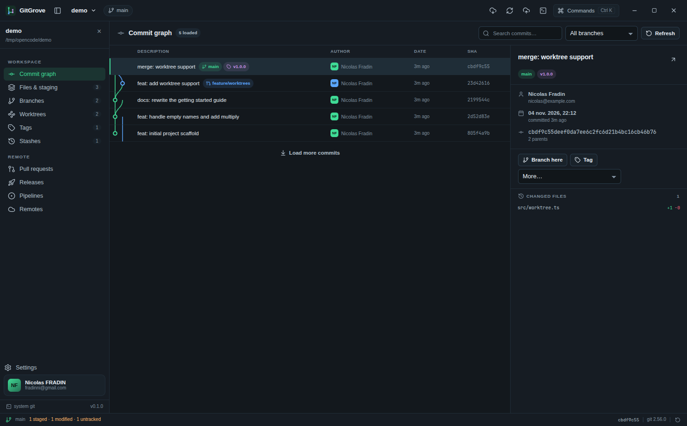
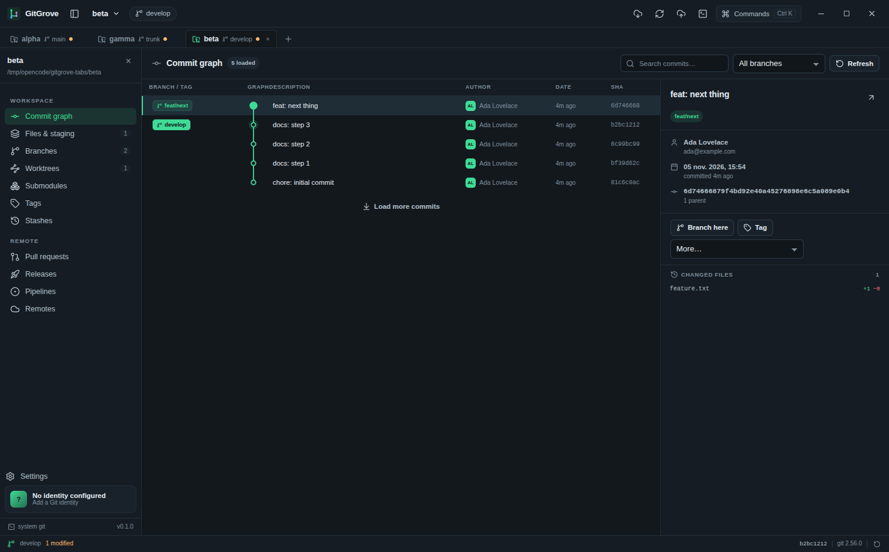
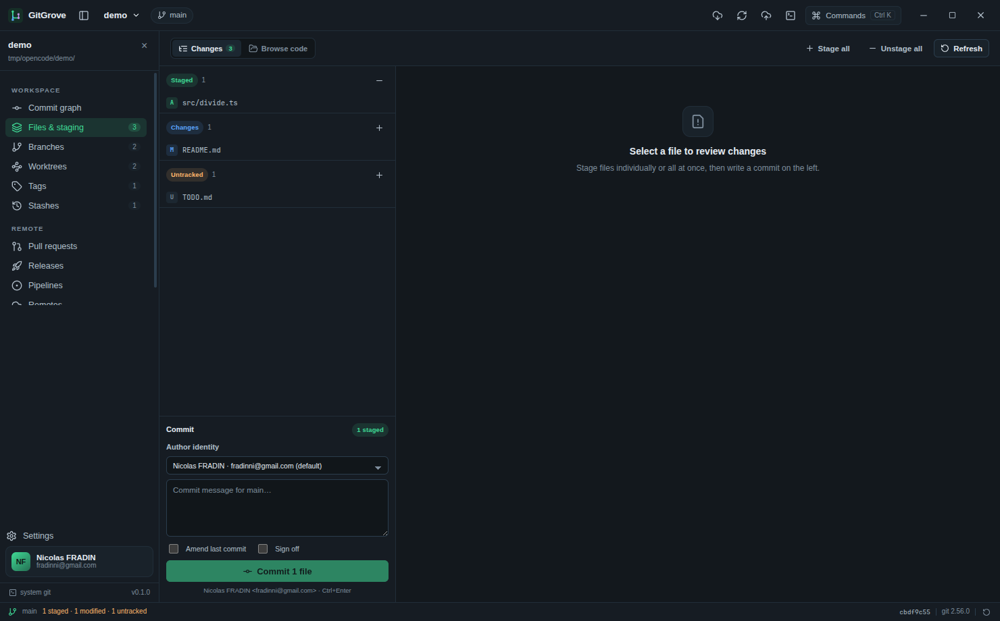
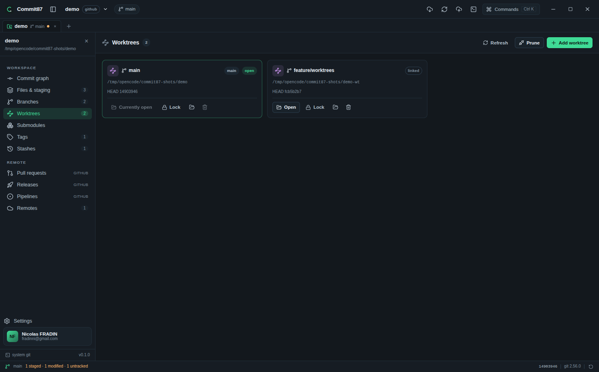
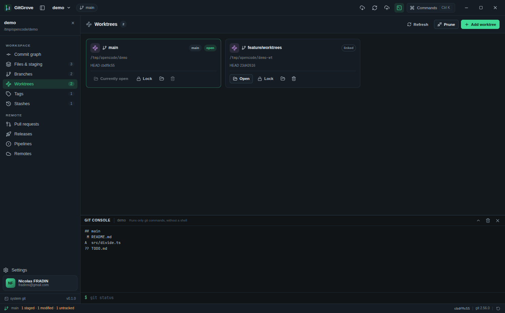
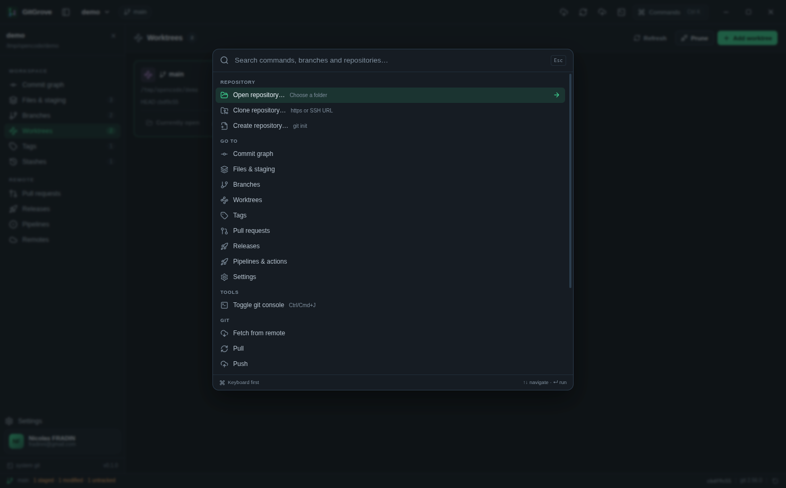

<div align="center">
  <a href="https://github.com/fradinni/Commit87">
    
  </a>
</div>

<div align="center">

[](https://github.com/fradinni/Commit87/actions/workflows/ci.yml)
[](https://github.com/fradinni/Commit87/actions/workflows/dependabot/dependabot-updates)
[](https://github.com/fradinni/Commit87/actions/workflows/release.yml)

[](https://github.com/fradinni/Commit87/releases)
[](LICENSE)
[](https://github.com/fradinni/Commit87/releases)
[](https://github.com/fradinni/Commit87/actions/workflows/ci.yml)

[](https://www.electronjs.org/)
[](https://react.dev/)
[](https://nodejs.org/)
[](https://git-scm.com/)

**Every commit counts.** The Git client for people who already like Git.

</div>



## Why another Git client

Graphical Git clients usually reimplement Git to build their UI on top of it — and that is
where your hooks, filters, LFS, GPG signing, SSH config and `includeIf` identities quietly
stop working. Commit87 takes the other path: **a focused UI on top of the Git you already
trust.**

- **Real Git, not a re-implementation.** Every operation is a real `git` invocation, so your
  existing setup keeps working — including the parts nobody wrote a UI for.
- **Small by design.** Repositories, review, worktrees, tags, releases and pipelines.
  No boards, no issue tracker, no wiki, no AI panel.
- **Multi-account, per repository.** Several identities and forge accounts, bound per
  repository, per remote or per push.
- **Auditable.** Tokens in the OS credential store, a sandboxed renderer behind a strict CSP,
  and a git console that cannot spawn a shell.

## Features

### Repositories and code

| Area | What you get |
| --- | --- |
| Repositories | Open, clone (HTTPS/SSH, shallow, bare), init, recent list with pinning |
| Repository tabs | Keep several repositories open at once, each with its own view, selection, status and console; drag to reorder, middle-click to close |
| Commit graph | Lane layout, refs and tags, search, branch filter, load more, commit details |
| History actions | Branch here, tag here, cherry-pick, revert, reset (soft/mixed/hard), detached checkout |
| Staging | Staged / modified / untracked / conflicted groups, per-file stage, discard with undo |
| Commits | Amend, sign-off, `--allow-empty`, identity override per commit, Ctrl/Cmd+Enter |
| Code browsing | Worktree and `HEAD` file tree, syntax highlighting, blame, open in OS editor |
| Diffs | Unified diffs with per-file stats, binary detection, rename detection |





### Branches, worktrees and refs

- Local and remote branches with upstream and ahead/behind counts
- Checkout, create, rename, delete (with optional remote delete), set upstream
- Merge (`--no-ff`, `--ff-only`, squash) and rebase onto any branch
- Conflict-aware status bar with **Continue**, **Skip** and **Abort** for merge, rebase,
  cherry-pick, revert and `git am`
- Worktrees: add from a branch or a new branch, open side by side, lock/unlock with a
  reason, prune, force-remove
- Submodules: initialize, update to the recorded commit or the tracked branch, sync URLs,
  add with an optional branch, reset local work, remove (with an explicit force option) and
  open the nested repository; local changes and out-of-sync checkouts are flagged
- Tags: annotated or lightweight, push to a remote, delete locally and remotely
- Stashes: push (with untracked), apply, pop, drop



### Forge integrations

| Forge | Pull requests | Releases | Pipelines / actions |
| --- | --- | --- | --- |
| GitHub / GitHub Enterprise | yes | yes | Actions (list, dispatch) |
| GitLab (self-hosted included) | merge requests | yes | CI pipelines |
| Bitbucket Cloud | yes | — (API has none) | Pipelines |
| Gitea / Forgejo | yes | yes | Actions (tasks + dispatch) |

- Detect the forge from any remote URL (HTTPS, `ssh://`, `git@host:owner/repo`)
- Match a configured account to the remote host, or pin one per repository
- Check out a pull request locally (`refs/pull/N/head`, GitLab merge refs, or the source
  branch on Bitbucket/Gitea) into `pr-N`
- Create pull requests, create and delete releases, dispatch workflows and follow runs
- Never touches the network from the renderer: all API traffic runs in the main process

### Identity management

- Unlimited identities: label, name, email, optional SSH key and GPG key/signing
- Default identity plus per-repository override and per-account binding
- Every commit, merge, cherry-pick, revert, tag and stash records the selected identity
- Pushes authenticate with the selected integration account through an ephemeral
  credential helper — tokens never appear in `argv` or in the process list

### Updates

- In-place updates for the AppImage, the Windows NSIS installer and the macOS app bundle
  (installed from the release zip)
- Stable and beta channels; prerelease tags publish `beta.yml` and never reach stable
  installs
- Automatic check after launch with background download, or a manual check that waits for
  an explicit Download action
- Downloads are installed only by the **Restart & install** action, so quitting the app
  never swaps the binary without confirmation
- Progress, release notes and failures stay in Settings → Updates without exposing the
  feed or artifacts to the renderer
- Flatpak, Snap, portable, zip and package-manager builds are told where to update instead
  of being patched behind their back

### Built for the keyboard

| Shortcut | Action |
| --- | --- |
| `Ctrl/Cmd + K` | Command palette (commands, branches, recent repositories) |
| `Ctrl/Cmd + J` | Toggle the git console |
| `Ctrl/Cmd + O` | Open repository |
| `Ctrl/Cmd + Shift + O` | Clone repository |
| `Ctrl/Cmd + R` | Refresh repository |
| `Ctrl/Cmd + Enter` | Commit from the message box |
| `Ctrl + Tab` | Next repository tab |
| `Ctrl + Shift + Tab` | Previous repository tab |
| `Ctrl/Cmd + 1…9` | Jump to a repository tab |
| `Ctrl/Cmd + W` | Close the active repository tab |

The git console runs **only git commands, without a shell**, validates subcommands
against an allow-list, and blocks `-c`, `--git-dir`, alias definitions, `--exec` and
`submodule foreach`.




## Install

Prebuilt packages are produced by CI for every target and architecture:

| Platform | Formats |
| --- | --- |
| Linux | AppImage, `.deb` (Debian/Ubuntu/Mint), `.rpm` (Fedora/RHEL/openSUSE), `pacman` (Arch/Manjaro), `tar.gz`, Snap, Flatpak |
| Windows | NSIS installer, portable `.exe`, `.zip` (x64 and arm64) |
| macOS | `.dmg` and `.zip` (Apple Silicon arm64; Intel x64 temporarily paused) |

### Linux

```bash
# Debian / Ubuntu
sudo apt install ./Commit87-0.1.0-amd64.deb

# Fedora / RHEL
sudo dnf install ./Commit87-0.1.0-x86_64.rpm

# Arch
sudo pacman -U Commit87-0.1.0-x86_64.pkg.tar.zst

# Any distro, no install
chmod +x Commit87-0.1.0-linux-x86_64.AppImage
./Commit87-0.1.0-linux-x86_64.AppImage

# Flatpak
flatpak install --user Commit87-0.1.0-x86_64.flatpak
flatpak run fr.fradinni.Commit87

# Snap
sudo snap install --dangerous commit87_0.1.0_amd64.snap
```

Every Linux package depends on the system `git`; Flatpak and Snap additionally bundle
Git, OpenSSH and CA certificates because their sandbox cannot use the host binaries.

### Windows and macOS

Download the installer (`.exe` for x64/arm64, `.dmg` for Apple Silicon) from the release
page. Portable builds need no installation: the Windows portable `.exe` and the macOS
`.zip` run in place. macOS builds are signed and notarized when the release secrets are
configured.

> **macOS Intel (x64) is temporarily paused in CI** while GitHub-hosted `macos-13` runners
> are scarce. Build it locally with `npm run build:mac` (or run the Apple Silicon build
> under Rosetta) until the x64 entry is restored in `.github/workflows/`.

## Build from source

Requirements: Node.js 24+ and Git 2.30+.

```bash
npm install
npm run dev          # electron-vite dev server with HMR
npm run typecheck    # strict TypeScript for main, preload and renderer
npm test             # 162 unit and integration tests against real git
npm run build        # production bundles in out/
npm run pack:dir     # unpacked app in dist/linux-unpacked
```

Package the app:

```bash
npm run icons             # regenerate PNG/ICO/ICNS from build/icon.svg
npm run build:linux       # AppImage, deb, rpm, pacman, tar.gz
npm run build:win         # NSIS, portable, zip
npm run build:mac         # dmg, zip
npm run dist:flatpak      # Flatpak bundle (needs flatpak-builder)
npm run dist:snap         # Snap (needs snapcraft)
python3 scripts/package-linux.py deb rpm pacman   # no-fpm fallback packager
```

Do not use `--publish always` for a dry run; pass `--publish never` as CI does.

Linux packaging with `electron-builder` also needs `fakeroot`, `rpm` and `bsdtar`
(`libarchive-tools`); see [docs/packaging.md](docs/packaging.md#linux-packaging-details).

## Architecture

```
src/
├─ main/                      Electron main process (Node, full privileges)
│  ├─ index.ts                lifecycle, single instance, deep links
│  ├─ window.ts               hardened BrowserWindow, navigation guards
│  ├─ protocol.ts             commit87:// app scheme (no file:// renderer)
│  ├─ menu.ts                 native menu
│  ├─ store.ts                config + encrypted secrets, repo defaults
│  ├─ tasks.ts                streaming git tasks, console allow-list
│  ├─ git/
│  │  ├─ runner.ts            spawn wrapper, identity and credential env
│  │  ├─ parsers.ts           porcelain v2, log, refs, worktrees, submodules, blame
│  │  └─ repo.ts              typed operations over system git
│  ├─ providers/              GitHub, GitLab, Bitbucket, Gitea clients
│  └─ ipc/router.ts           one validated channel table, no dynamic IPC
├─ preload/index.ts           contextBridge surface (invoke + events)
├─ shared/                    types and the typed IPC contract
└─ renderer/                  React 19 UI (sandboxed, no Node access)
   └─ src/{components,views,lib,styles}
```

**Process boundaries.** The renderer never sees a token, a path outside the chosen repo,
or a `child_process`. It calls a single `commit87:invoke` channel with a discriminated
envelope; the router re-validates every argument, resolves identity/account permissions
and returns either a value or a sanitized error.

**Git execution.** `git/runner.ts` spawns Git with `shell: false`,
`GIT_TERMINAL_PROMPT=0`, `GIT_EDITOR=true`, `GIT_SEQUENCE_EDITOR=true` and a non-parsing
`--no-pager` baseline. Long operations (clone/fetch/pull/push/console) stream stdout and
stderr line by line through `TaskManager`, which redacts known secrets before sending
anything to the renderer.

**Identity and credentials.** `buildIdentityEnv` exports `GIT_AUTHOR_*` / `GIT_COMMITTER_*`
and inline `-c user.*` values, and sets `GIT_SSH_COMMAND` for per-identity SSH keys.
`buildAuthArgs` installs a throwaway credential helper that reads the username and token
from the environment, so secrets never appear in `argv`, `ps`, shell history or task logs.

**Renderer serving.** The production renderer is served by a privileged `commit87://`
scheme instead of `file://`. That allows `grantFileProtocolExtraPrivileges: false` and
`onlyLoadAppFromAsar: true` while keeping ES modules and a strict CSP working.

See [docs/architecture.md](docs/architecture.md) for the full design and data flow.

## Security model

- `contextIsolation: true`, `sandbox: true`, `nodeIntegration: false`, no `webview`
- Strict CSP: no remote script, no inline script, no `unsafe-eval`, `object-src 'none'`
- Navigation and `window.open` are blocked; http(s) links open in the system browser
- Tokens encrypted with Electron `safeStorage` (OS keychain) when available; otherwise
  stored in `secrets.json` with mode `0600` and clearly reported in Settings
- IPC accepts only the known channel table and only from the main window's webContents
- Git console: git-only, allow-listed subcommands, no shell, no config writes
- Path traversal is rejected for every file, worktree and repository argument
- Electron fuses disable `runAsNode`, `NODE_OPTIONS`, CLI inspect and extra `file://`
  privileges, and enable ASAR integrity validation

Report vulnerabilities via [SECURITY.md](SECURITY.md).

## Project layout

```
docs/                architecture, packaging, testing, screenshots
build/               icons, installer and entitlement resources
scripts/             icon generation, version sync, Flatpak/Snap/deb/rpm/pacman helpers
flatpak/ snap/       native manifests
src/                 application source (see above)
tests/               vitest suites (parsers, providers, git integration, security)
```

## Roadmap

Current priorities, in order:

1. **Diff review comments and inline PR review**
2. **Git LFS status and pull/prune actions**

Next up:

- [ ] Windows ARM64 native ARM build validation on hardware

Shipped:

- [x] Auto-update channels for AppImage, NSIS and DMG, with stable and beta feeds
- [x] Multiple simultaneous repository tabs, each with per-repository state
- [x] Interactive rebase editor (todo list, squash, reword) inside the app
- [x] Submodule management UI

## License

MIT — see [LICENSE](LICENSE).